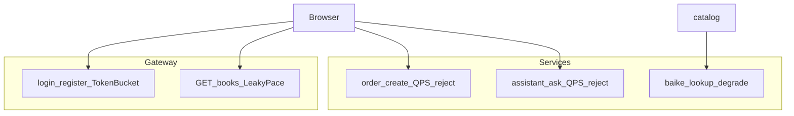

# 第八期：限流、令牌桶 / 漏桶对照、百科熔断

第七期已撤 Seata、对照读配置。本期只做入口与贵操作保护，以及外部百科熔断。支付、退款、改价、扣库存契约、MQ/`bizKey`、Dashboard 不进本期。

下面这些维持现状，不进本期：

- 不对 `catalog.deduct` / `restore`、订单→图书 Feign 扣库存做熔断或假成功降级。
- 不部署 Sentinel Dashboard；规则用本地 JSON / 网关配置，不接 Nacos 动态规则源。
- 登录/注册**不再**额外叠一层 Sentinel 流控（令牌桶只用 Guava，避免和「Sentinel 没有令牌桶」讲混）。
- `/internal/**`、通知消费、死信重放不加 Sentinel。
- 不改真实支付、物流、优惠等范围外能力。

## 目标与对照

为学习把三种限流行为落到不同接口上，外加百科熔断：



| 落点 | 算法 | 实现 | 体感 |
| --- | --- | --- | --- |
| `POST /api/users/login`、`register` | 令牌桶 | 网关 Guava `RateLimiter` | 短突发可能过，平均超速后 429 |
| `GET /api/books` | 漏桶式匀速排队 | Sentinel `controlBehavior=2` | 先变慢排队，等超时再 429 |
| `order-create`、`assistant-ask` | QPS 硬拒绝 | Sentinel `controlBehavior=0` | 超阈值立刻 429，不排队 |
| `baike-lookup` | 熔断 | Sentinel degrade | 持续失败快速失败 → 现有 `50302` |

Sentinel 自带行为与教材对应：`0` 硬拒绝、`1` 预热、`2` 匀速排队≈漏桶。它**没有**经典令牌桶，故登录/注册用 Guava。

## 依赖

- [bookmall-gateway/pom.xml](bookmall-gateway/pom.xml)：`spring-cloud-alibaba-sentinel-gateway`；Guava 跟 Boot BOM（缺则显式加）。
- [bookmall-order/pom.xml](bookmall-order/pom.xml)、[bookmall-assistant/pom.xml](bookmall-assistant/pom.xml)、[bookmall-catalog/pom.xml](bookmall-catalog/pom.xml)：`spring-cloud-starter-alibaba-sentinel`。
- 不把 Sentinel 放进 `bookmall-common`。
- 父工程已有 SCA `2023.0.3.2` BOM。

## 规则来源（本地，无 Dashboard）

```yaml
spring:
  cloud:
    sentinel:
      enabled: true
      eager: true
      transport:
        dashboard: ""
      datasource:
        flow:
          file:
            file: classpath:sentinel/flow-rules.json
            data-type: json
            rule-type: flow
        degrade:
          file:
            file: classpath:sentinel/degrade-rules.json
            data-type: json
            rule-type: degrade
```

开发期建议阈值（可用 `application-dev.yml` / 独立规则文件覆盖，**不写死在业务 if**）：

- 令牌桶：`bookmall.rate-limit.login-rate`、`register-rate` ≈ `5.0` / 秒（配置名以实现时统一为准）。
- `GET:/api/books`：`count≈20`，`controlBehavior=2`，`maxQueueingTimeMs≈500`。
- `order-create` / `assistant-ask`：`count≈3`–`5`，`controlBehavior=0`。
- `baike-lookup`：异常比例约 `0.5`，`minRequestAmount=5`，`timeWindow=10s`。

图书列表规则示例：

```json
[
  {
    "resource": "GET:/api/books",
    "grade": 1,
    "count": 20,
    "controlBehavior": 2,
    "maxQueueingTimeMs": 500
  }
]
```

## 代码接入

1. **网关令牌桶**  
   `TokenBucketGatewayFilter`（或等价 `WebFilter`）匹配登录/注册。`tryAcquire()` 失败 → HTTP `429`，正文 `ApiResponse`：`code=42901`，`message=请求过于频繁`（写法对齐 [JwtGatewayFilter](bookmall-gateway/src/main/java/com/bookmall/gateway/filter/JwtGatewayFilter.java)）。

2. **网关漏桶**  
   启用 Sentinel Gateway 过滤器；自定义 Block 处理器，响应与上相同。资源按方法+路径，避免误伤整个 catalog 路由。

3. **订单**  
   [OrderController.create](bookmall-order/src/main/java/com/bookmall/order/controller/OrderController.java)（或薄封装）`@SentinelResource("order-create")`，`blockHandler` 抛 `BusinessException(429, 42901, "请求过于频繁")`，走 [GlobalExceptionHandler](bookmall-common/src/main/java/com/bookmall/common/error/GlobalExceptionHandler.java)。与现有 [CheckoutLock](bookmall-order/src/main/java/com/bookmall/order/service/CheckoutLock.java) 互补：锁串行同用户读购物车，Sentinel 挡过载。

4. **客服**  
   [AssistantController.ask](bookmall-assistant/src/main/java/com/bookmall/assistant/controller/AssistantController.java) 资源 `assistant-ask`。限流必须在写出 SSE **之前**；block 时仍是 JSON 包络，不是半截事件流。

5. **百科熔断**  
   [HttpBaikeClient.lookup](bookmall-catalog/src/main/java/com/bookmall/catalog/baike/HttpBaikeClient.java) 资源 `baike-lookup`。熔断/限流 block 与 `RestClientException` 一样 → `BusinessException(503, 50302, ...)`。[BookCompareService](bookmall-catalog/src/main/java/com/bookmall/catalog/service/BookCompareService.java) 按本标 `UNAVAILABLE` 的逻辑可继续用。`FakeBaikeClient`（test）不加 Sentinel。

## 文档与错误码

- [docs/接口文档.md](docs/接口文档.md) 错误码表增加：`42901` / HTTP `429` /「请求过于频繁」。
- [docs/需求规格说明书.md](docs/需求规格说明书.md) 写明第八期：三种限流落点、百科熔断、本地规则、无 Dashboard、不对扣库存熔断。

## 测试

- 令牌桶：把 rate 调极低，连续请求断言随后出现 `42901`。
- 匀速排队：极低 `count` + 短 `maxQueueingTimeMs`，并发下部分变慢、超额 `42901`。
- 硬拒绝 / 熔断：测试中 `FlowRuleManager` / `DegradeRuleManager` 加载规则后断言 `42901` / `50302`。
- 回归订单库存与对照相关用例；改过的行为有用例再结束。

## 刻意不做

- Sentinel Dashboard、Nacos 规则数据源  
- 登录再叠一层 Sentinel  
- 扣库存路径熔断  
- 用 Sentinel 冒充令牌桶讲解
