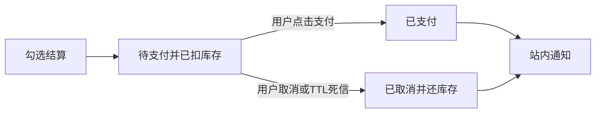

# 纸间书店第三版开发计划

真实支付和微信、支付宝登录这期不做。代码量本身中等，但没有商户号和已审核的开放平台应用时，本地跑不通，会把这期卡住。

## 为什么不放进这期

当前登录是用户名密码换 JWT（[`UserController`](bookmall-user/src/main/java/com/bookmall/user/controller/UserController.java) 的 `/api/users/login`，前端只把令牌放在 `localStorage` 的 `bookmall.token`）。下单在 [`OrderService.create`](bookmall-order/src/main/java/com/bookmall/order/service/OrderService.java) 里当场扣库存并写成状态 `1`，接口字面量 `CREATED`，没有支付回调。

- **微信/支付宝登录**：授权码回调、绑定本地用户、再签发现有 JWT，这条链路本身不长。网站应用要企业认证、备案域名和审核，回调必须是已登记的 HTTPS 域名，localhost 无效。微信内网页授权还要求已认证服务号。支付宝沙箱的登录能力也不稳定。没有这些账号，做完无法按前两期的方式验收。
- **真实支付**：预下单、验签、异步通知幂等、金额核对，官方 SDK 能写。微信支付已没有可用的公开沙箱，要企业商户号和 API 证书。支付宝沙箱可以走电脑网站支付，但通知地址必须公网可达，密钥不能进前端包。它还会改掉「下单即扣库存并完成」这条现有主路径。退款仍明确不做。

以后若已有支付宝沙箱应用和公网回调地址，可以单开一小期只接支付宝沙箱，支付状态机沿用本期。微信登录和微信支付仍等有开放平台与商户号再做。

**Feign 和 Seata 也不放进这期。** 订单调图书服务走 [`CatalogClient`](bookmall-order/src/main/java/com/bookmall/order/client/CatalogClient.java) 的 `RestClient`：3 秒超时，把目录的 `40006` / `40400` 转成订单侧的 `BusinessException`。调用点只有图书查询、扣库存、回补，再加一条通知补发。没有注册中心，地址是配置项 `bookmall.catalog-base-url`。换成 OpenFeign 只是把同一条 HTTP 改成接口声明，错误码和超时还得自己写，还要改正在加支付和超时关单的扣库存路径。

库存对齐靠 `stock_hold` 令牌：先落令牌，再扣库存，写订单失败用同一令牌回补。通知走 RabbitMQ，失败不回滚订单。Seata AT 要另起 TC、两边库加 `undo_log`，还得把目录扣库存卷进全局事务。它盖不住「通知失败不得回滚订单」，也会换掉本期超时关单要复用的还库存路径。令牌补偿不够用时再单开 Seata，不和支付状态机绑在一起。

**注册中心也不加。** 四个服务都是单实例。本地网关写死 `localhost:8081`–`8084`，订单用 `bookmall.catalog-base-url`。Compose 和 Kubernetes 用服务名（`http://catalog:8082` 等），Kubernetes Service 已经按副本做发现和负载均衡。Nacos 或 Eureka 要再起一个进程，五个服务都要注册，网关要从固定地址改成从注册中心取实例。本期的勾选结算、支付和死信都不依赖实例列表。等某个服务要在没有 Kubernetes 的环境里扩成多副本、客户端自己选实例时，再单独加注册中心，并一起改 Feign 或负载均衡。

## 本期纳入

不推翻二期主流程：网关、四服务、Redis、RabbitMQ、管理端上下架、取消还库存。

- **勾选结算**：[`Cart.vue`](bookmall-web/src/views/Cart.vue) 加勾选，合计只算选中行。`POST /api/orders` 接受 `itemIds`；缺省仍结算全部购物车，空数组返回 400。只删除已结算的购物车行。去掉现在对 `itemIds` 的拒绝（「第一版仅支持结算全部购物车」）。
- **模拟支付**：新订单状态为待支付，库存仍在下单时按现有令牌扣减。用户在订单详情点「支付」后改为已支付，不再动库存。仅待支付可取消，仍走现有还库存。已支付不可取消。历史 `status = 1` 的订单迁移为已支付，避免旧演示订单全部变成待支付。
- **超时关单**：不用延迟消息插件。下单后向 TTL 队列发一条消息，过期后经死信进入超时队列；消费者看到仍是待支付就按取消路径还库存。开发环境 TTL 可配短（例如 1 分钟），默认 15 分钟。
- **通知死信**：[`NotificationConsumer`](bookmall-notification/src/main/java/com/bookmall/notification/mq/NotificationConsumer.java) 保持参数错误记日志后确认。数据库等瞬时失败有限次重试，超过后进死信队列，不再无限重新入队。订单侧与通知侧的队列声明保持一致。

状态约定（库内数字，接口字符串，界面中文）：

- `1` / `PENDING_PAY` / 待支付（新下单）
- `2` / `CANCELLED` / 已取消（用户取消或超时）
- `3` / `PAID` / 已支付

## 明确不做

真实微信/支付宝支付与退款、微信/支付宝登录、OpenFeign、Seata、Nacos/Eureka 等注册中心、物流地址、优惠、评价、全部已读、服务网格。支付页不出现真实二维码或跳转收银台。服务间调用继续用现有 `RestClient` 和固定地址（本地端口、Compose/Kubernetes 服务名），扣库存继续用令牌回补。

## 文档与注释

更新 [`docs/需求规格说明书.md`](docs/需求规格说明书.md)、[`docs/接口文档.md`](docs/接口文档.md) 和订单状态 SQL 注释，使评审规则里的「当前版本文档」包含勾选结算和模拟支付。新增和改到的 Java、Vue、队列声明写中文注释，说明状态迁移、超时关单和死信边界。

## 测试

正反例：未勾选、勾选部分、结算全部、重复支付、已支付再取消、超时关单还库存、通知毒消息进死信、二期取消与管理端回归。发现问题则改代码、重启相关服务、从失败用例复验。页面用 Playwright MCP 打开本机 Chrome，走勾选下单、支付、取消，验证完关闭页面。
