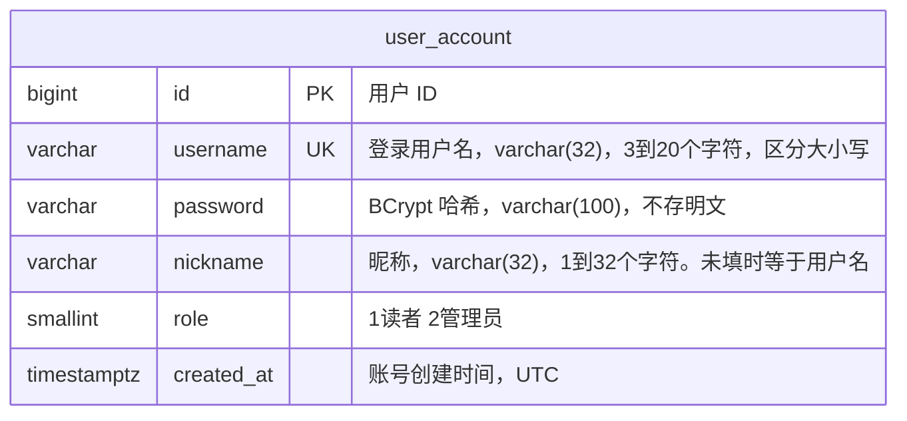
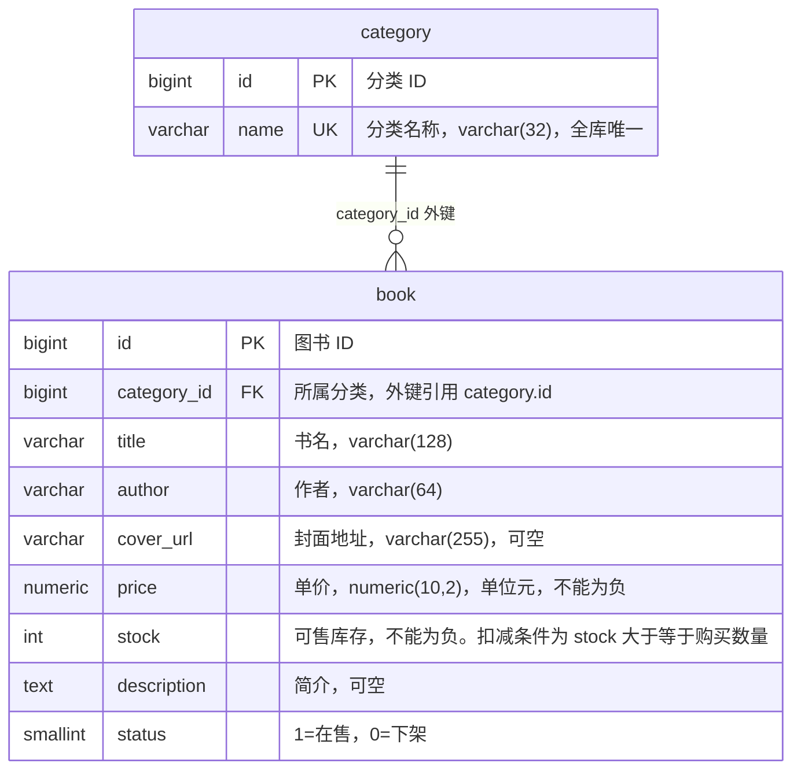
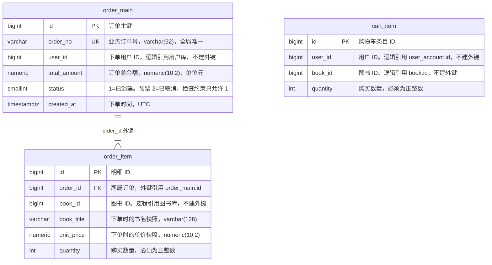
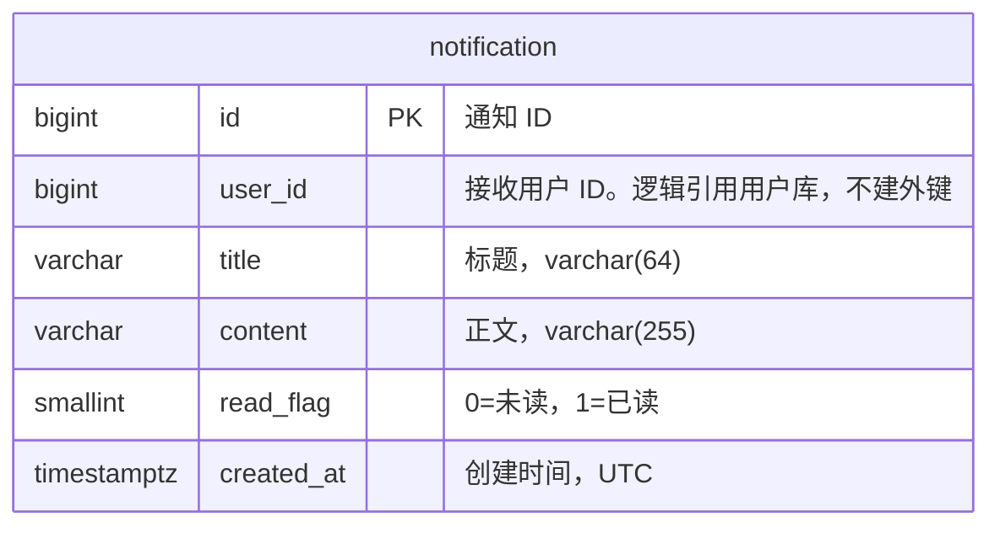
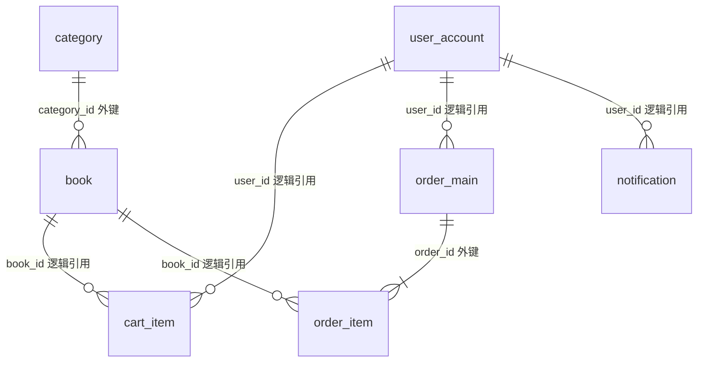

# 数据库设置

第一版使用 PostgreSQL 16。一个实例、四个库，每个服务一个登录角色，只连接自己的库。表结构对应《需求规格说明书》第 5 章。可执行脚本在 `docs/sql/`。

跨库的 `user_id`、`book_id` 只保存数字，**不建外键**。订单明细里的书名和单价是下单快照，不随图书表更新。

## 1. 库与账号

| 库                       | 所属服务       | 登录角色                        | 本地口令                        | JDBC URL                                                 |
| ----------------------- | ---------- | --------------------------- | --------------------------- | -------------------------------------------------------- |
| `bookmall_user`         | 用户服务 :8081 | `bookmall_user_app`         | `bookmall_user_dev`         | `jdbc:postgresql://localhost:5432/bookmall_user`         |
| `bookmall_book`         | 图书服务 :8082 | `bookmall_book_app`         | `bookmall_book_dev`         | `jdbc:postgresql://localhost:5432/bookmall_book`         |
| `bookmall_order`        | 订单服务 :8083 | `bookmall_order_app`        | `bookmall_order_dev`        | `jdbc:postgresql://localhost:5432/bookmall_order`        |
| `bookmall_notification` | 通知服务 :8084 | `bookmall_notification_app` | `bookmall_notification_dev` | `jdbc:postgresql://localhost:5432/bookmall_notification` |

口令只给本机开发。`PUBLIC` 对这些库的连接权限已收回，别的角色默认连不进去。

本地启动实例（数据目录为空时才会初始化；建库脚本需要在容器起来之后手工执行）：

```yaml
services:
  postgres:
    image: postgres:16
    environment:
      POSTGRES_PASSWORD: postgres
    ports:
      - "5432:5432"
    volumes:
      - bookmall-pg:/var/lib/postgresql/data
volumes:
  bookmall-pg:
```

超级用户用 `postgres` / `postgres` 执行第 2 节的脚本。业务服务运行时改用上表里的角色，不要用超级用户。

## 2. 执行顺序

在仓库根目录执行。已存在同名角色或库时，`01` 会失败，需要先删掉再执行。

```text
psql -U postgres -h localhost -p 5432 -d postgres -f docs/sql/01-create-databases.sql
psql -U postgres -h localhost -p 5432 -d bookmall_user -f docs/sql/02-bookmall-user.sql
psql -U postgres -h localhost -p 5432 -d bookmall_book -f docs/sql/03-bookmall-book.sql
psql -U postgres -h localhost -p 5432 -d bookmall_book -f docs/sql/06-seed-book.sql
psql -U postgres -h localhost -p 5432 -d bookmall_order -f docs/sql/04-bookmall-order.sql
psql -U postgres -h localhost -p 5432 -d bookmall_notification -f docs/sql/05-bookmall-notification.sql

# 第二版增量（已有一期库时执行）
psql -U postgres -h localhost -p 5432 -d bookmall_user -f docs/sql/07-phase2-user.sql
psql -U postgres -h localhost -p 5432 -d bookmall_order -f docs/sql/07-phase2-order.sql
psql -U postgres -h localhost -p 5432 -d bookmall_notification -f docs/sql/07-phase2-notification.sql

# 第三版增量（已有二期库时执行）
psql -U postgres -h localhost -p 5432 -d bookmall_order -f docs/sql/08-phase3-order.sql
```

Docker 里没有本机 `psql` 时，把文件送进容器：

```text
docker exec -i bookmall-postgres psql -U postgres -d postgres -f - < docs/sql/01-create-databases.sql
```

其余文件同样通过 `-d` 指定目标库。`06-seed-book.sql` 不能重复执行。

## 3. ER 图

图和 `docs/sql/02` 到 `05` 的建表脚本一致。主键都是 `bigint GENERATED BY DEFAULT AS IDENTITY`。库内实线是外键；跨库的 `user_id`、`book_id` 只存数字，图上标成逻辑引用，数据库里没有外键。

### 3.1 用户库 `bookmall_user`



### 3.2 图书库 `bookmall_book`



没有 `isbn` 列。详情接口无数据时固定返回 `null`。列表只查 `status = 1`。

### 3.3 订单库 `bookmall_order`



`cart_item` 有唯一约束 `(user_id, book_id)`，同一用户同一本书只有一行。数量减到 0 时应用删除该行，不把数量写成 0。购物车和订单没有外键：下单成功后写入订单明细，再清空该用户的购物车。

图书库另有 `stock_change(token, book_id, quantity, kind)`。`token` 主键，`kind` 为 1 表示已扣减、2 表示已回补。订单库另有 `stock_hold(token, user_id, book_id, quantity)`，记下尚未和订单一起提交的扣减。两边用同一个 `token`。

### 3.4 通知库 `bookmall_notification`



### 3.5 四库合在一起

实线里只有两条是数据库外键：`book.category_id`、`order_item.order_id`。其余连线都是逻辑引用。



用户删了、图书下架或删除后，购物车和历史订单里的 ID 仍然留着。订单展示用 `order_item.book_title` 和 `order_item.unit_price`，不回图书库查当前书名和价格。

## 4. 建库 SQL

对应 `docs/sql/01-create-databases.sql`。

```sql
CREATE ROLE bookmall_user_app LOGIN PASSWORD 'bookmall_user_dev';
CREATE ROLE bookmall_book_app LOGIN PASSWORD 'bookmall_book_dev';
CREATE ROLE bookmall_order_app LOGIN PASSWORD 'bookmall_order_dev';
CREATE ROLE bookmall_notification_app LOGIN PASSWORD 'bookmall_notification_dev';

CREATE DATABASE bookmall_user OWNER bookmall_user_app ENCODING 'UTF8';
CREATE DATABASE bookmall_book OWNER bookmall_book_app ENCODING 'UTF8';
CREATE DATABASE bookmall_order OWNER bookmall_order_app ENCODING 'UTF8';
CREATE DATABASE bookmall_notification OWNER bookmall_notification_app ENCODING 'UTF8';

REVOKE ALL ON DATABASE bookmall_user FROM PUBLIC;
REVOKE ALL ON DATABASE bookmall_book FROM PUBLIC;
REVOKE ALL ON DATABASE bookmall_order FROM PUBLIC;
REVOKE ALL ON DATABASE bookmall_notification FROM PUBLIC;

GRANT CONNECT ON DATABASE bookmall_user TO bookmall_user_app;
GRANT CONNECT ON DATABASE bookmall_book TO bookmall_book_app;
GRANT CONNECT ON DATABASE bookmall_order TO bookmall_order_app;
GRANT CONNECT ON DATABASE bookmall_notification TO bookmall_notification_app;
```

## 5. 建表 SQL

主键一律 `bigint GENERATED BY DEFAULT AS IDENTITY`。时间一律 `timestamptz`，应用按 UTC 写入。金额用 `numeric(10,2)`，单位元。每个字段都有中文注释。状态和已读标记用 `smallint` 存数字：

| 字段                       | 值 | 含义                    |
| ------------------------ | - | --------------------- |
| `book.status`            | 1 | 在售                    |
| `book.status`            | 0 | 下架                    |
| `order_main.status`      | 1 | 已创建。预留 2=已取消，第一版不允许写入 |
| `notification.read_flag` | 0 | 未读                    |
| `notification.read_flag` | 1 | 已读                    |

### 5.1 用户库

对应 `docs/sql/02-bookmall-user.sql`。`password` 只存 BCrypt 哈希（约 60 字符）。用户名长度 3–20 与需求一致；是否含空白由应用校验。

```sql
CREATE TABLE user_account (
    id         bigint GENERATED BY DEFAULT AS IDENTITY PRIMARY KEY,
    username   varchar(32)  NOT NULL,
    password   varchar(100) NOT NULL,
    nickname   varchar(32)  NOT NULL,
    created_at timestamptz  NOT NULL DEFAULT now(),
    CONSTRAINT uq_user_account_username UNIQUE (username),
    CONSTRAINT ck_user_account_username_len CHECK (char_length(username) BETWEEN 3 AND 20),
    CONSTRAINT ck_user_account_nickname_len CHECK (char_length(nickname) BETWEEN 1 AND 32)
);
```

### 5.2 图书库

对应 `docs/sql/03-bookmall-book.sql`。`isbn` 没有这一列。库存检查约束保证不会出现负数；扣减时应用还要写 `UPDATE ... SET stock = stock - ? WHERE id = ? AND stock >= ?`。

```sql
CREATE TABLE category (
    id   bigint GENERATED BY DEFAULT AS IDENTITY PRIMARY KEY,
    name varchar(32) NOT NULL,
    CONSTRAINT uq_category_name UNIQUE (name),
    CONSTRAINT ck_category_name_len CHECK (char_length(name) BETWEEN 1 AND 32)
);

CREATE TABLE book (
    id          bigint GENERATED BY DEFAULT AS IDENTITY PRIMARY KEY,
    category_id bigint         NOT NULL,
    title       varchar(128)   NOT NULL,
    author      varchar(64)    NOT NULL,
    cover_url   varchar(255),
    price       numeric(10, 2) NOT NULL,
    stock       integer        NOT NULL,
    description text,
    status      smallint       NOT NULL,
    CONSTRAINT fk_book_category FOREIGN KEY (category_id) REFERENCES category (id),
    CONSTRAINT ck_book_price_nonneg CHECK (price >= 0),
    CONSTRAINT ck_book_stock_nonneg CHECK (stock >= 0),
    CONSTRAINT ck_book_status CHECK (status IN (0, 1))
);

CREATE INDEX idx_book_category_id ON book (category_id);
CREATE INDEX idx_book_title ON book (title);
```

### 5.3 订单库

对应 `docs/sql/04-bookmall-order.sql`。`order_no` 在需求里只写了唯一，这里同时设为 `NOT NULL`。订单状态第一版只允许 `1`（已创建）；做取消订单时再允许 `2`（已取消）。

```sql
CREATE TABLE cart_item (
    id       bigint GENERATED BY DEFAULT AS IDENTITY PRIMARY KEY,
    user_id  bigint  NOT NULL,
    book_id  bigint  NOT NULL,
    quantity integer NOT NULL,
    CONSTRAINT uq_cart_item_user_book UNIQUE (user_id, book_id),
    CONSTRAINT ck_cart_item_quantity_pos CHECK (quantity > 0)
);

CREATE TABLE order_main (
    id           bigint GENERATED BY DEFAULT AS IDENTITY PRIMARY KEY,
    order_no     varchar(32)    NOT NULL,
    user_id      bigint         NOT NULL,
    total_amount numeric(10, 2) NOT NULL,
    status       smallint       NOT NULL,
    created_at   timestamptz    NOT NULL DEFAULT now(),
    CONSTRAINT uq_order_main_order_no UNIQUE (order_no),
    CONSTRAINT ck_order_main_total_nonneg CHECK (total_amount >= 0),
    CONSTRAINT ck_order_main_status CHECK (status IN (1))
);

CREATE TABLE order_item (
    id         bigint GENERATED BY DEFAULT AS IDENTITY PRIMARY KEY,
    order_id   bigint         NOT NULL,
    book_id    bigint         NOT NULL,
    book_title varchar(128)   NOT NULL,
    unit_price numeric(10, 2) NOT NULL,
    quantity   integer        NOT NULL,
    CONSTRAINT fk_order_item_order FOREIGN KEY (order_id) REFERENCES order_main (id),
    CONSTRAINT ck_order_item_unit_price_nonneg CHECK (unit_price >= 0),
    CONSTRAINT ck_order_item_quantity_pos CHECK (quantity > 0)
);

CREATE INDEX idx_order_main_user_created ON order_main (user_id, created_at DESC);
CREATE INDEX idx_order_item_order_id ON order_item (order_id);
```


```


```

### 5.4 通知库

对应 `docs/sql/05-bookmall-notification.sql`。

```sql
CREATE TABLE notification (
    id         bigint GENERATED BY DEFAULT AS IDENTITY PRIMARY KEY,
    user_id    bigint       NOT NULL,
    title      varchar(64)  NOT NULL,
    content    varchar(255) NOT NULL,
    read_flag  smallint     NOT NULL DEFAULT 0,
    created_at timestamptz  NOT NULL DEFAULT now(),
    CONSTRAINT ck_notification_read_flag CHECK (read_flag IN (0, 1))
);

CREATE INDEX idx_notification_user_created ON notification (user_id, created_at DESC);
```

```

## 6. 图书种子数据

对应 `docs/sql/06-seed-book.sql`。3 个分类、28 本在售图书，库存都大于 0。前 8 本的书名和价格与原型示意一致，其后 20 本是补充书目。`cover_url` 为空，封面由前端占位。

| id | 分类 | 书名 | 作者 | 价格 | 库存 |
| --- | --- | --- | --- | --- | --- |
| 1 | 文学 | 围城 | 钱钟书 | 39.80 | 12 |
| 2 | 文学 | 活着 | 余华 | 28.00 | 20 |
| 3 | 文学 | 三体 | 刘慈欣 | 68.00 | 15 |
| 4 | 文学 | 小王子 | 圣埃克苏佩里 | 25.00 | 30 |
| 5 | 技术 | 编程思想 | 埃克尔 | 108.00 | 8 |
| 6 | 技术 | 计算机系统 | 布莱恩特 | 139.00 | 6 |
| 7 | 技术 | 设计模式 | 弗里曼 | 79.00 | 9 |
| 8 | 生活 | 人类简史 | 赫拉利 | 68.00 | 10 |
| 9 | 文学 | 红楼梦 | 曹雪芹 | 45.00 | 18 |
| 10 | 文学 | 百年孤独 | 马尔克斯 | 39.80 | 16 |
| 11 | 文学 | 挪威的森林 | 村上春树 | 36.00 | 22 |
| 12 | 文学 | 平凡的世界 | 路遥 | 58.00 | 14 |
| 13 | 文学 | 月亮与六便士 | 毛姆 | 32.00 | 24 |
| 14 | 文学 | 解忧杂货店 | 东野圭吾 | 35.00 | 20 |
| 15 | 文学 | 追风筝的人 | 胡赛尼 | 39.00 | 17 |
| 16 | 文学 | 边城 | 沈从文 | 22.00 | 26 |
| 17 | 技术 | 代码整洁之道 | 马丁 | 69.00 | 11 |
| 18 | 技术 | 重构 | 福勒 | 79.00 | 9 |
| 19 | 技术 | 人月神话 | 布鲁克斯 | 49.00 | 13 |
| 20 | 技术 | 算法导论 | 科尔曼 | 128.00 | 7 |
| 21 | 技术 | 流畅的Python | 拉马略 | 99.00 | 10 |
| 22 | 技术 | 代码大全 | 麦克康奈尔 | 108.00 | 8 |
| 23 | 技术 | 数据库系统概念 | 西尔伯沙茨 | 89.00 | 6 |
| 24 | 生活 | 思考，快与慢 | 卡尼曼 | 69.00 | 15 |
| 25 | 生活 | 非暴力沟通 | 卢森堡 | 42.00 | 19 |
| 26 | 生活 | 原则 | 达利欧 | 88.00 | 12 |
| 27 | 生活 | 自控力 | 麦格尼格尔 | 45.00 | 21 |
| 28 | 生活 | 断舍离 | 山下英子 | 38.00 | 23 |

插入时指定了 `id`，脚本末尾用 `setval` 把身份序列拨到当前最大值，避免下一本新书主键冲突。
```


## 4. 第二版增量

| 脚本 | 库 | 变更 |
| --- | --- | --- |
| `07-phase2-user.sql` | bookmall_user | `user_account.role`（1 读者 / 2 管理员）；种子 `admin` / `admin123456` |
| `07-phase2-order.sql` | bookmall_order | `order_main.status` CHECK 允许 1、2（已创建、已取消） |
| `08-phase3-order.sql` | bookmall_order | 原 status=1 改为 3（已支付）；CHECK 允许 1 待支付、2 已取消、3 已支付 |
| `07-phase2-notification.sql` | bookmall_notification | `notification.biz_key` 唯一（部分索引，NULL 可多行） |

新建环境：先跑 01–06，再跑上述 07 脚本。
